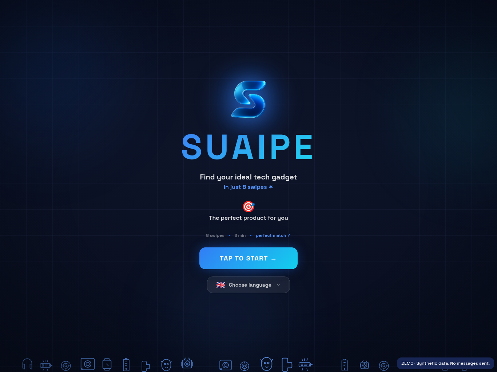
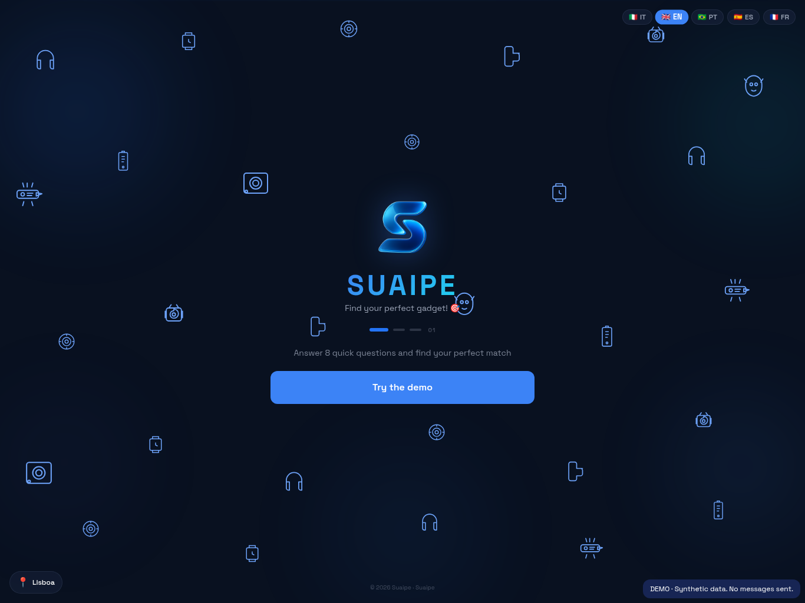
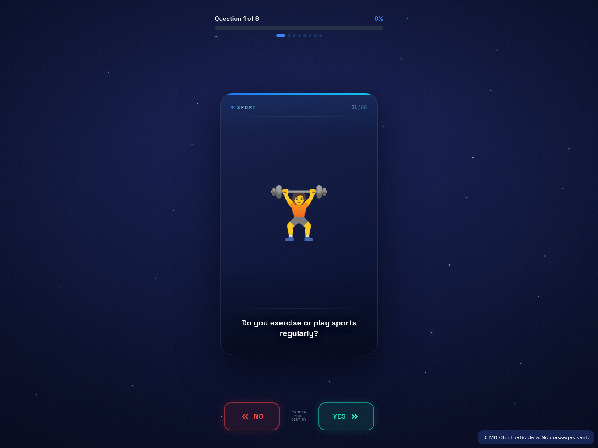
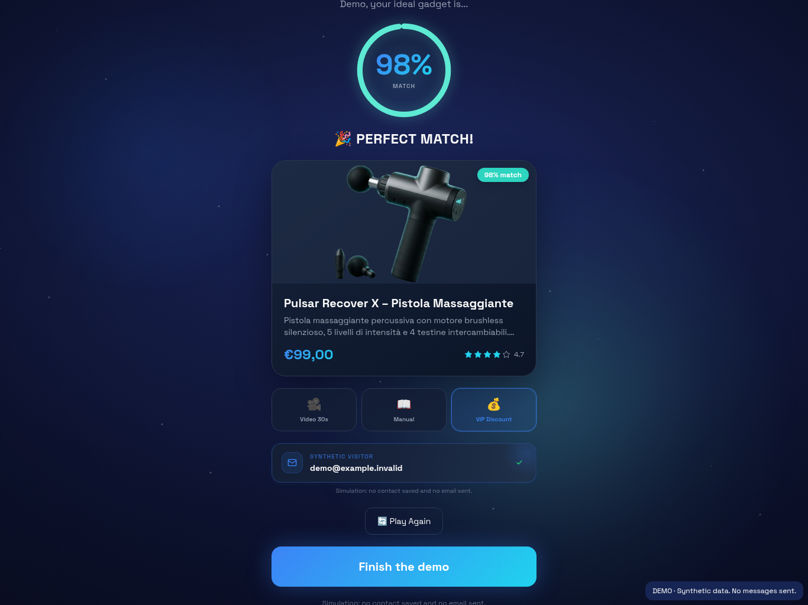
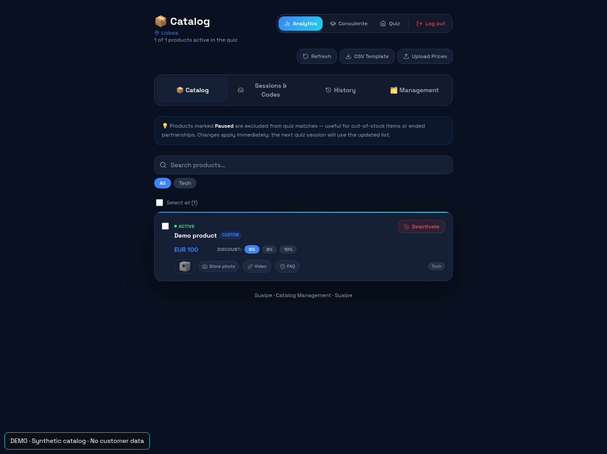
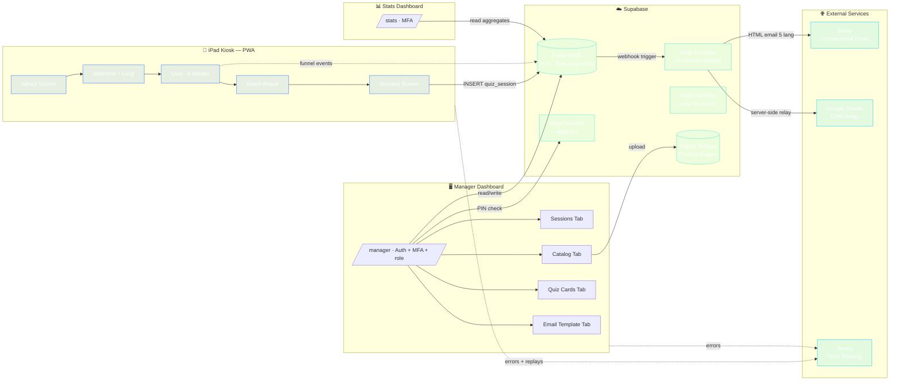

<div align="center">


# 🎯 Suaipe

**An iPad-first product discovery kiosk for physical retail**

[](https://github.com/ProgAnakin/Suaipe/actions/workflows/ci.yml)
[](./CHANGELOG.md)
[](./src/__tests__)
[](./src/i18n/translations.ts)
[](https://www.typescriptlang.org/)
[](https://react.dev/)
[](https://supabase.com/)
[](./LICENSE)

*Customers swipe through 8 personalised questions — Tinder-style — and receive an instant product recommendation with a tailored discount and a personalised video from a consultant.*

### 🌐 Portfolio demonstration

*The current candidate uses synthetic data. A hosted URL will be listed after provider and `/release.json` verification. See [current release validation](docs/releases/2026-11-07/README.md).*

*Best experienced on iPad (1024×1366) in landscape · Works on any modern browser*

</div>

---

## Overview

**Suaipe** turns idle in-store iPads into a conversion-driving touchpoint. A customer answers eight quick swipe questions, a matching algorithm recommends one product, generates a unique discount code, and delivers a personalised follow-up email in the customer's language. The flow is designed for a short in-store visit.

**Built for:** physical retail with a curated catalog — tech, beauty, gifts, sporting goods, fragrance — where customers know roughly what they want but get overwhelmed by choice.

**Status:** 2.1.0 release candidate on `fix/security-and-release-hardening`. Local validation is recorded below; hosted rollout remains to be verified. The current store configurations are demonstration examples. Intended audience: Europe, especially Italy, Portugal, Spain and France.

### What it delivers

- 📥 **First-party lead capture** with a versioned privacy notice and recorded consent; legal suitability depends on the operator's purposes and configuration
- 🎯 **Product matchmaking** — eight questions to one recommendation, reduces choice paralysis
- 🎟️ **Personalised discount codes** generated server-side and emailed in the customer's chosen language (IT / EN / PT / ES / FR)
- 🏪 **Multi-store, per-store catalogs** managed from a single dashboard, with one-click "send products to another store" between locations
- 📊 **Real-time analytics** — conversion funnel, per-store breakdowns, code-redemption tracking
- 🎓 **Consultant training module** — manager-authored sales guides per product, used to onboard new sales staff

---

## 📸 Demo

> Current browser captures with synthetic data, including a separate authenticated staff fixture. Public demo staff routes remain disabled. [Capture provenance](docs/screenshots/README.md). These are not production metrics.

<table align="center">
  <tr>
    <td align="center"><b>Attract loop</b></td>
    <td align="center"><b>Welcome</b></td>
    <td align="center"><b>Quiz</b></td>
    <td align="center"><b>Match Result</b></td>
    <td align="center"><b>Manager Dashboard</b></td>
  </tr>
  <tr>
    <td></td>
    <td></td>
    <td></td>
    <td></td>
    <td></td>
  </tr>
</table>

---

## 🏗️ Architecture



**Data flow at a glance:**

1. Customer completes quiz → `quiz_sessions` row inserted
2. Database webhook fires `on-session-created` Edge Function
3. Edge Function generates a unique discount code, builds a multilingual HTML email and dispatches it via Brevo
4. The same Edge Function relays the lead to Google Sheets (CRM)
5. Manager dashboard observes everything in real-time via Supabase Realtime subscriptions

---

## ✨ Features

### Customer-facing (kiosk)
- 🃏 **Tinder-style swipe quiz** — 8 questions, gesture-driven, haptic feedback
- 🌍 **5 languages** — Italian, English, Portuguese, Spanish, French
- 🧠 **Product matching** — tag-overlap scoring across 8 product categories with random tie-break
- 🎁 **Personalised discount codes** — unique per session, 24-hour validity enforced by the server
- 📧 **Multilingual automated emails** — product info, consultant video, discount, FAQ — all translated to the language the customer picked
- 🎵 **Synthesised ambient soundtrack** — Web Audio API generative music, zero audio assets
- 💤 **Inactivity reset** — auto-returns to attract loop after 45s of idle (90s on result screen)
- 🔒 **Wake lock** — prevents iPad screen from sleeping
- 📵 **Offline-capable PWA** — app asset precaching, explicit public-catalog snapshots, graceful degradation

### Manager dashboard (`/manager`)
- 📊 **Real-time sessions** — live updates via Supabase Realtime, KPI cards, advanced filters (date, product, match %), CSV export, retention purge
- 🛍️ **Product catalogue** — slug-collision-safe custom products, per-store overrides (price, image, video, discount %), drag-and-drop quiz cards
- ✉️ **Email template editor** — live preview, server-enforced 24-hour code validity
- 🏪 **Multi-store support** — per-store activation, role-based access (`manager` sees all, `consulente_responsabile` sees own store)
- ⌨️ **Keyboard shortcuts** — `Ctrl+S` refresh, `Esc` close modals

### Stats dashboard (`/stats`)
- 📈 **Funnel analysis** — `quiz_started → result_shown → claimed` conversion
- 📦 **Product performance** — match distribution, redemption rate, lead volume
- 🏬 **Per-store breakdowns** — comparative store analytics

### Consultant training zone (`/consulente`)
- 🎓 **Read-only product knowledge base** for sales consultants
- 📝 **Per-product guides** — description, two selling insights and the manager's advice, authored in `/manager` (no generative AI calls in the product runtime)
- 👁️ **Customer-facing description mirror** — shows the exact text the customer reads on their match result
- 🌍 **IT / EN toggle** with Italian fallback

---

## 🎯 Use Cases

Suaipe is designed for tech retail and other curated catalogs; suitability for another category requires validation.

| Use case | Where it fits |
|---|---|
| **In-store lead capture** | Storefronts that want a structured, disclosed contact flow with recorded consent and retention controls. |
| **Choice-paralysis catalogs** | Tech, beauty, fragrance, sporting goods, wine, gifts — categories with 20–100 products where the customer needs guidance to one. |
| **Gift-finding (seasonal)** | Christmas, birthdays, anniversaries, Valentine's. Customer answers about the recipient, gets a match — converts indecision into a sale. |
| **Multi-store chains** | Each location curates its own active catalog with per-store pricing, imagery and discounts; one dashboard manages all of them; "send to store" copies a setup between locations. |
| **Pop-ups, events, brand activations** | Installable PWA — boots on any iPad, no per-event setup. Useful for product launches, fairs, in-store campaigns. |
| **Sales-staff training** | The `/consulente` module gives each product a sales guide (description, two insights, manager's advice, video link) — used to onboard new floor staff. |
| **First-party contact records** | Store recommendation results and contacts for the disclosed purposes. A result-email request does not automatically authorize later marketing. |
| **Merchandising analytics** | Funnel + product-performance dashboards reveal which products customers gravitate to — informs assortment, procurement and per-store stocking. |

---

## 🛡️ Security & Quality Highlights

| Category | Implementation |
|---|---|
| **Authentication** | Supabase Auth + role/MFA guards · server-only PIN verification with persistent origin lockout and a server-side hash fallback · validate hosted gateway/Auth configuration before release |
| **Authorisation** | Row-Level Security on every table · role-based access (`manager` / `consulente_responsabile` / `consulente`) · per-store data isolation |
| **PII Protection** | Customer `nome`/`cognome`/`email` readable only by authenticated managers (all stores) and consulenti (own store) — no anon access · platform (disk-level) at-rest encryption, **not** column-level — protected by role-scoped RLS, see [ADR 003](./docs/adr/003-pii-encryption-at-rest.md) · retention purge of old sessions |
| **Rate Limiting** | Server-enforced claim/address and per-store quotas, atomic email reservation and persistent PIN lockout; public quotas alone do not prove a human visitor |
| **Injection Defence** | Search escaping, contextual email escaping, server-side template tag allowlist, name validation and formula-safe CSV/Sheets output |
| **CORS** | Strict origin allowlist · no wildcard fallback · silent rejection of unexpected origins |
| **Webhooks** | DB webhooks gated by valid `store_id` allowlist · unknown stores silently dropped |
| **Accessibility** | Kiosk-targeted tap targets (≥ 64 px on the PIN keypad and quiz buttons) · `focus-visible:ring-2` rings on interactive elements · `prefers-reduced-motion` respected via Framer Motion `MotionConfig` · informational copy bumped above the `/65` opacity threshold for in-store lighting |
| **Internationalisation** | 5 fully translated languages, including the transactional emails sent to customers |
| **Testing** | 234 unit tests (Vitest) · 21 browser scenarios defined (18 functional Chromium checks passed; 3 WebKit visual cases pending) · typecheck + lint + build on every push via GitHub Actions |
| **Observability** | Optional minimized Sentry errors without replay/tracing; optional private sourcemap upload/removal · authenticated hourly health check and daily retention workflow, requiring operator configuration |
| **Performance** | Manual chunk splitting · lazy-loaded admin routes · image auto-resize ≤ 1024px JPEG q=80 · PWA precaching · debounced search |
| **iPad / Kiosk** | `interactive-widget=resizes-content` prevents URL bar on keyboard · `visualViewport` API for keyboard-aware layouts · iOS splash screens · wake lock · `100dvh` everywhere |

---

## ⚡ Performance

| Concern | Approach | Notes |
|---|---|---|
| **Bundle (main chunk)** | ~60 KB gzip | Manual `manualChunks` splits react-vendor, framer-motion, supabase and radix into separate cacheable chunks; admin routes lazy-loaded |
| **LCP** | Attract screen paints from CSS only | No image in the critical path |
| **PWA** | Full manifest + service worker + public-catalog snapshots | Installable on iPad standalone; claims require connectivity |
| **Image pipeline** | Auto-resize ≤ 1024 px JPEG q=80 | Runs in the manager catalog before Supabase Storage upload |
| **Search debounce** | 300 ms | Prevents a DB hit on every keystroke |
| **Animation budget** | ≤ 0.15 s stagger | Capped to prevent jank on 20+ row session lists on iPad |

> Run `npx lighthouse https://suaipe.vercel.app --view` to benchmark on your own network.

---

## 🗂️ Architecture Decision Records

Key architectural trade-offs are documented in [`docs/adr/`](./docs/adr/):

| ADR | Decision |
|-----|---------|
| [001](./docs/adr/001-supabase-over-firebase.md) | Supabase (PostgreSQL + RLS + pgcrypto) over Firebase |
| [002](./docs/adr/002-pwa-over-native.md) | PWA over native iOS app (with Capacitor escape hatch) |
| [003](./docs/adr/003-pii-encryption-at-rest.md) | PII protection — superseded: access-control over app-layer encryption (keeps search) |
| [004](./docs/adr/004-swipe-quiz-over-form.md) | Tinder-style swipe quiz over a traditional form |
| [005](./docs/adr/005-synchronous-pii-encryption.md) | Synchronous PII encryption before email dispatch — superseded (see ADR 003) |
| [006](./docs/adr/006-english-only-staff-ui.md) | Staff dashboards are English-only (the customer kiosk stays multilingual) |

---

## 🧰 Tech Stack

| Layer | Technology |
|-------|-----------|
| **Framework** | React 18 + TypeScript |
| **Build** | Vite + SWC |
| **Animations** | Framer Motion (with `reducedMotion="user"`) |
| **Styling** | Tailwind CSS + shadcn/ui |
| **State** | React Query · Context |
| **Backend** | Supabase (PostgreSQL + Edge Functions + RLS + Storage + Realtime) |
| **Email** | Brevo (transactional API) |
| **CRM** | Google Sheets (server-side relay) |
| **Audio** | Web Audio API (synthesised generative loop) |
| **Errors** | Sentry (browser tracing + replays) |
| **PWA** | vite-plugin-pwa + Workbox |
| **Drag & Drop** | @dnd-kit/core + @dnd-kit/sortable |
| **Tests** | Vitest + Testing Library + Playwright |
| **CI** | GitHub Actions (typecheck · lint · test · build) |
| **Deploy** | Vercel (auto-deploy on push to `main`) |
| **Native** | Capacitor (iOS + Android builds supported) |

---

## 📁 Project Structure

```
src/
├── assets/              # Static brand assets (logo, envelope image)
├── components/
│   ├── ui/              # shadcn/ui base components
│   ├── manager/         # Manager dashboard (sessions, catalog, quiz cards, email)
│   ├── stats/           # Analytics dashboard components
│   ├── AttractScreen    # Idle attract loop
│   ├── WelcomeScreen    # Language selection + data capture
│   ├── QuizScreen       # 8-question swipe quiz orchestrator
│   ├── SwipeCard        # Individual Tinder-style card
│   ├── MatchResult      # Product recommendation display
│   ├── SuccessScreen    # Post-claim confirmation
│   └── ErrorBoundary    # App-level crash recovery screen
├── data/
│   ├── products.ts      # Product catalog + matching algorithm
│   ├── quiz-cards.ts    # Dynamic quiz question schema
│   └── stores.ts        # Store configuration
├── hooks/               # useDebounce, useWakeLock, useInactivityReset, useBgMusic, useViewportKeyboard…
├── i18n/                # Full translations in 5 languages
├── integrations/        # Supabase client + generated types
├── lib/                 # imageProcessing, startupCache, validators, haptic, clientId, utils
└── pages/               # Route-level page components

supabase/
├── functions/
│   ├── on-session-created/   # Email dispatch · CRM relay · multilingual templates
│   ├── verify-pin/           # Staff PIN auth with IP-based lockout
│   ├── relay-to-sheets/      # Google Sheets relay (JWT + manager/MFA)
│   └── privacy-maintenance/  # Secret-authenticated health/retention
└── migrations/               # Versioned SQL migrations (RLS, rate limits, RPC functions)
```

---

## 🚀 Getting Started

### Prerequisites

- Node.js 24 LTS (see `.nvmrc`)
- npm
- Supabase project (URL + anon key)

### Local Setup

```bash
git clone https://github.com/ProgAnakin/Suaipe.git
cd Suaipe
npm ci
cp .env.example .env
# Use VITE_DEMO_MODE=true for an isolated local demonstration;
# configure the public backend variables only for real backend development.
npm run dev
```

### Environment Variables

```env
VITE_SUPABASE_URL=https://your-project.supabase.co
VITE_SUPABASE_PUBLISHABLE_KEY=sb_publishable_...
VITE_DEMO_MODE=true
# For real operation: VITE_DEMO_MODE=false and the actual controller/contact.
# VITE_PRIVACY_CONTROLLER=...
# VITE_PRIVACY_CONTACT=...
# Optional error monitoring requires VITE_ENABLE_ERROR_MONITORING=true
# plus VITE_SENTRY_DSN. Full configuration: .env.example and deploy guide.
```

### Available Scripts

| Command | Purpose |
|---------|---------|
| `npm run dev` | Vite dev server with HMR |
| `npm run build` | Production build |
| `npm run preview` | Preview production build locally |
| `npm test` | Run Vitest unit tests |
| `npm run lint` | ESLint check |
| `npm run cap:ios` | Build + open iOS Capacitor project |
| `npm run cap:android` | Build + open Android Capacitor project |

---

## 📦 Deployment

With the Vercel Git integration configured, a push can request a frontend deployment. All builds, including Production, default to synthetic demo mode. Real collection additionally requires `VITE_ALLOW_REAL_CUSTOMER_DATA=true`. A push does not deploy SQL or Edge Functions and does not prove provider success. Follow [DEPLOY-2.1.0.md](docs/DEPLOY-2.1.0.md) for the coordinated rollout and `/release.json` verification. Security headers, CSP, HSTS and SPA routing are declared in `vercel.json`; verify their hosted responses.

The CI workflow runs typecheck, lint, test and build on every push to `main`, every PR, and every `claude/*` / `feat/*` / `fix/*` branch.

---

## 🗄️ Database

| Table | Purpose |
|-------|---------|
| `quiz_sessions` | One row per completed quiz — email, answers, matched product, store, discount code, language |
| `quiz_funnel_events` | Conversion funnel tracking (`quiz_started` / `result_shown` / `claimed`) |
| `product_settings` | Per-store product activation, pricing, images, videos, discounts, FAQ |
| `custom_products` | Per-store custom products (with collision-safe slug IDs) |
| `quiz_cards` | Dynamic quiz question schema with drag-and-drop ordering |
| `email_template` | Editable email template (subject, header title, subtitle, footer) |
| `product_guides` | Per-product consultant training guides shown in `/consulente` |
| `product_guide_files` | Downloadable manuals/spec sheets per product (schema ready, UI on standby) |
| `store_roles` | Role-based access mapping (`manager` / `consulente_responsabile` / `consulente`) |
| `manager_audit_log` | Dashboard action audit trail |
| `admin_access_log` | PIN access tracking with IP + user-agent |
| `app_settings` | Hashed application secrets (bcrypt PIN hash) |

Every table is protected by Row-Level Security. Rate limiting is enforced at the database-function level. Customer PII in `quiz_sessions` is readable only by authenticated managers/consulenti (scoped by store, no anon access). PII columns are plaintext, protected by role-scoped RLS plus the platform's disk-level at-rest encryption — **not** application-layer column encryption (deliberately dropped to keep partial-match search; see [ADR 003](./docs/adr/003-pii-encryption-at-rest.md)).

---

## 🛣️ Admin Routes

| Route | Access | Purpose |
|-------|--------|---------|
| `/manager` | PIN-protected | Product, quiz card, store, email-template and consultant-guide configuration · session & code tracking |
| `/stats` | MFA-protected | Session data, funnel metrics, per-store performance |
| `/consulente` | Login + role | Read-only product training zone for sales consultants |
| `/reset-password` | Public | Password reset flow |

---

## 🖼️ Product Images

Place core product images in `public/products/` and reference them in `src/data/products.ts`. Recommended format: PNG, 600×600px, transparent background. Per-store images can be overridden via the Manager Dashboard (uploaded to Supabase Storage and auto-resized to 1024px JPEG, q=80).

---

## 🗺️ Roadmap

The design can use entry-level service plans, but actual eligibility, quotas, runner minutes and costs depend on the operator and providers. Confirm current terms and budgets before corporate use. The items below remain follow-up work.

### Security & data integrity

- **App-layer PII encryption (optional, deferred by choice).** Customer `email`/`nome`/`cognome` are currently protected by access control (role-scoped RLS) + platform at-rest encryption rather than application-layer AES, because encrypting them would break the dashboard's partial-match search. A future release could encrypt them at rest with a server-side decrypt RPC (key in Supabase Vault) and switch email/name lookups to exact-match HMAC — accepted trade-off: no more partial search on those fields.
- **Hosted authorization verification.** The current migrations enforce MFA on sensitive SQL/Storage operations. Exercise these policies with real roles, tokens and uploads in staging; local SQL stand-ins do not certify the hosted service.

### Optional observability

- **Structured logging for Edge Functions.** Logflare or Better Stack drain (~€10/mo) so failures in `verify-pin` / `on-session-created` / `relay-to-sheets` get queryable, retained beyond Supabase's rolling window.
- **Lighthouse CI + bundle-size budgets.** Fail PRs that regress LCP or grow a chunk past its budget. Deferred until the catalog actually grows — premature on a 4-store pilot.

### Resilience (paid tiers)

- **Automated daily database backups.** Backup and point-in-time recovery availability depends on the Supabase plan and configured add-ons; verify the current plan and test restores. Real recovery validation is required before customer-data operation.
- **Public status page.** A read-only health endpoint (Vercel + Supabase + Brevo) so store staff can self-diagnose outages without calling support.

### Developer experience

- **Tests for the remaining untested hooks.** `useIdleLogout`, `useBgMusic`, `useSound`, `useDevicePerformance`, `useViewportKeyboard` — none are security-critical, but worth covering before the catalog grows.
- **Visual regression for the swipe interaction.** Pixel-diff coverage for the static shells (404, reset-password, manager login) is in place; the dynamic quiz cards and match result are still uncovered because their content varies per run.

---

<div align="center">


</div>

---

## 👤 Author & License

**Costanzo Annichini**

Suaipe was conceived, designed and built end-to-end as an independent personal project. Architected and shipped solo — from the swipe interaction and matching algorithm to the Supabase backend, security model, multilingual email automation, and the manager + consultant dashboards.

- **GitHub:** [github.com/ProgAnakin](https://github.com/ProgAnakin)
- **LinkedIn:** [linkedin.com/in/costanzoannichini](https://www.linkedin.com/in/costanzoannichini/)

Architectural decisions: [`docs/adr/`](./docs/adr/) · Operational triage: [`docs/runbook.md`](./docs/runbook.md) · Release history: [`CHANGELOG.md`](./CHANGELOG.md)

### License

Proprietary — © Costanzo Annichini. All rights reserved.

## Security release deployment

These changes require a coordinated database, Edge Function and frontend rollout. See [the 2.1.0 deployment guide](docs/DEPLOY-2.1.0.md) and [AI/maintainer handoff](docs/AI-HANDOFF.md) before deploying this branch.

For the release's current contracts and verification limits, read [AI-HANDOFF.md](docs/AI-HANDOFF.md), the [317-control register](docs/readiness/README.md) and [latest results](docs/releases/2026-11-07/README.md). All builds default to a synthetic portfolio demo; real deployment also requires SQL/Edge updates and scheduled privacy maintenance. Third-party components retain their own licenses; acknowledgements are in [public/third-party-notices.txt](public/third-party-notices.txt).
