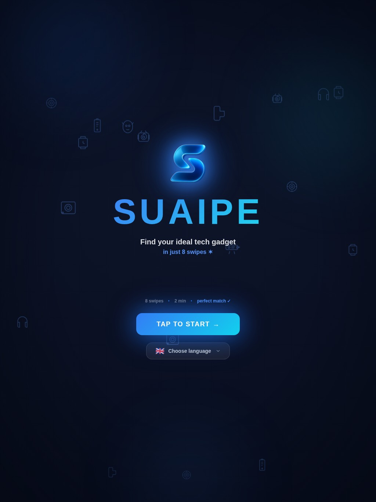
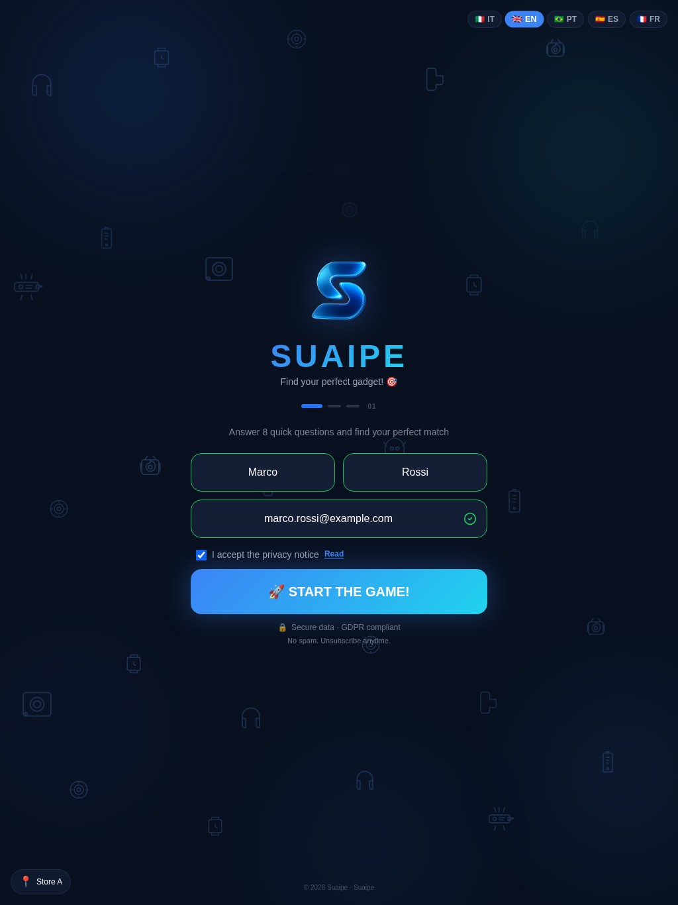
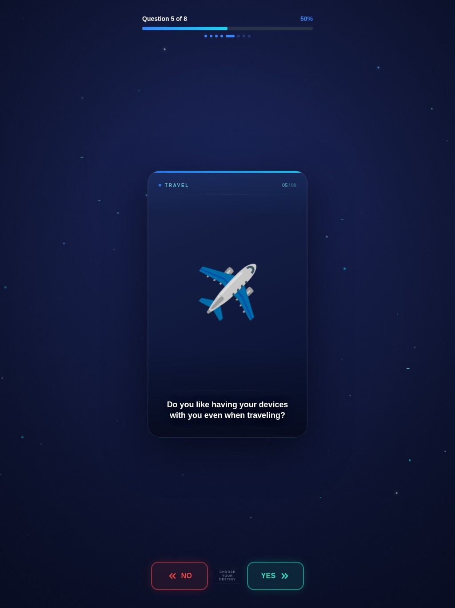
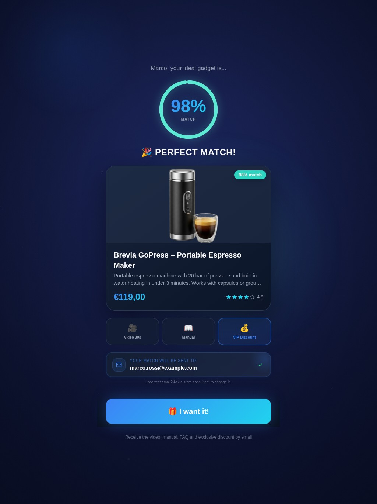
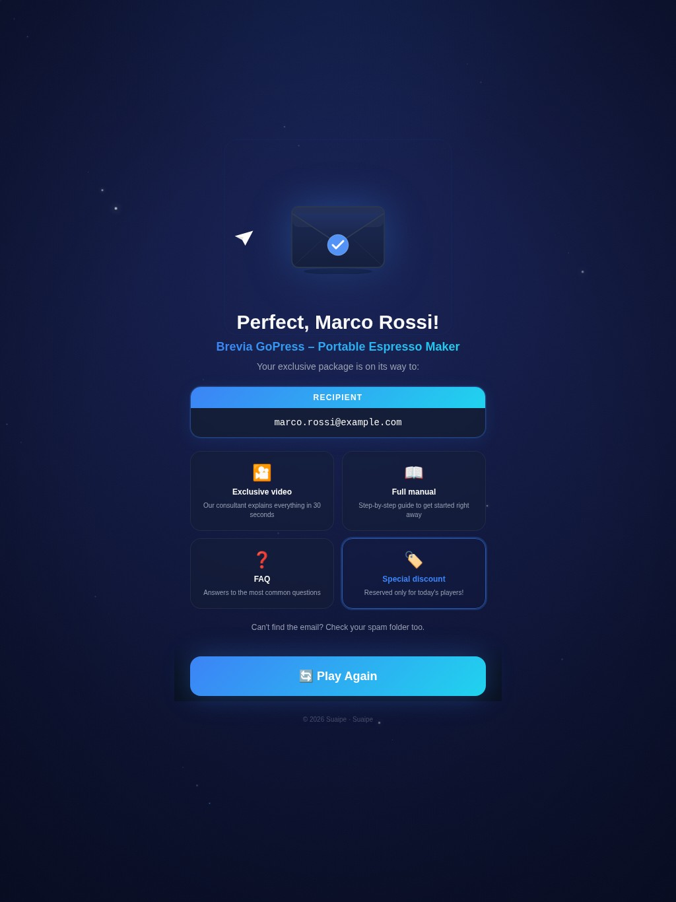
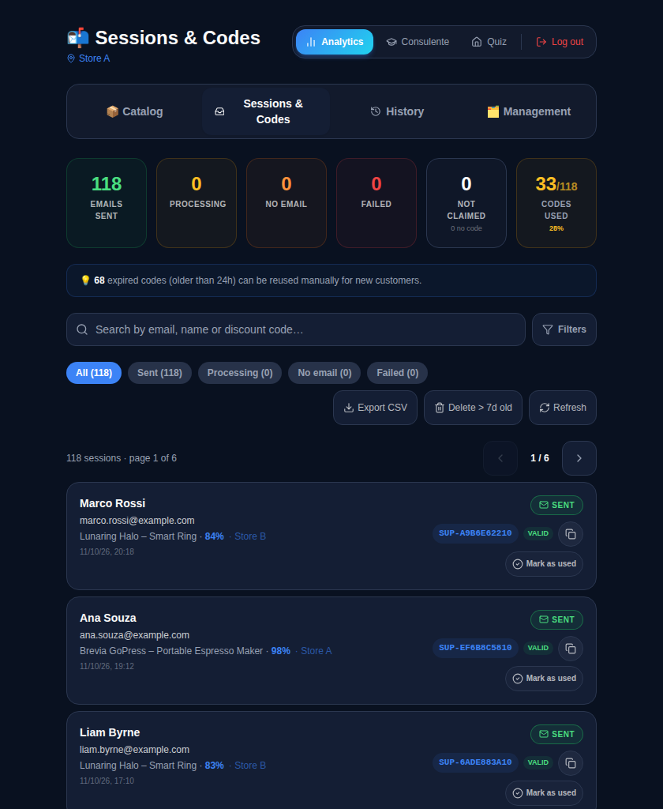
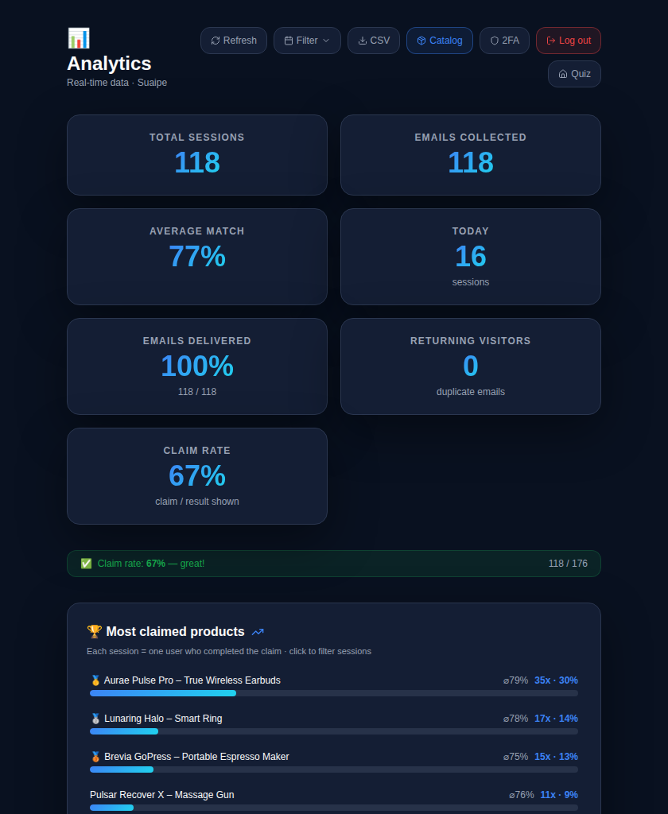
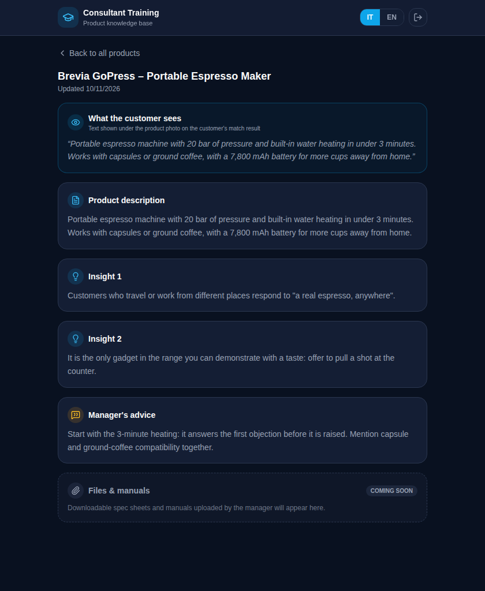
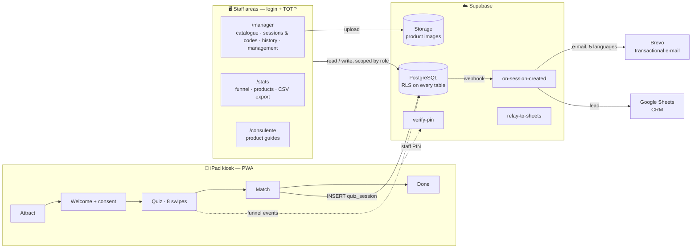

<div align="center">


# Suaipe

**An iPad-first product-discovery kiosk for physical retail.**

[](https://github.com/ProgAnakin/Suaipe/actions/workflows/ci.yml)
[](./CHANGELOG.md)
[](#-quality)
[](./src/i18n/translations.ts)
[](https://www.typescriptlang.org/)
[](https://react.dev/)
[](https://supabase.com/)
[](./LICENSE)

*A customer swipes through eight questions, gets one product recommendation with a personal discount code, and receives a follow-up e-mail in their own language. The store gets consented, first-party leads, a CRM feed and per-store numbers.*

### 🌐 [**Live demo → suaipe.vercel.app**](https://suaipe.vercel.app)

*Made for an iPad on a stand · works in any modern browser*

</div>

---

## Overview

**Suaipe** turns an idle in-store iPad into a conversion touchpoint. A customer answers eight swipe questions; a matching algorithm recommends **one** product from the store's own catalogue and issues a unique discount code; a personalised e-mail follows, in the customer's language. The whole experience takes about two minutes and runs unattended.

**Built for** physical retail with a curated catalogue — tech, beauty, gifts, sports, fragrance — where customers roughly know what they want but are overwhelmed by choice.

**Status:** in production on iPad across four stores.

### What it delivers

- 📥 **First-party lead capture** with explicit GDPR consent, recorded with a timestamp for every lead
- 🎯 **One recommendation, not a catalogue** — eight questions in, one product out
- 🎟️ **Personal discount codes** issued server-side and e-mailed in IT / EN / PT / ES / FR
- 🏪 **Multi-store** — each store has its own active catalogue, prices, photos and discounts, managed from one dashboard
- 📊 **Numbers that add up** — conversion funnel, per-store breakdowns, code redemption (exact beyond 1,000 leads, exportable)
- 🎓 **Consultant training** — manager-written sales guides per product

---

## 📸 Screens

> Generated from the real app with fictional sample data (`npm run docs:screenshots` — see [`docs/screenshots`](./docs/screenshots/README.md)).

**The kiosk**

<table align="center">
  <tr>
    <td align="center"><b>Attract</b></td>
    <td align="center"><b>Welcome</b></td>
    <td align="center"><b>Quiz</b></td>
    <td align="center"><b>Match</b></td>
    <td align="center"><b>Done</b></td>
  </tr>
  <tr>
    <td></td>
    <td></td>
    <td></td>
    <td></td>
    <td></td>
  </tr>
</table>

**The staff areas**

<table align="center">
  <tr>
    <td align="center"><b>Manager · Sessions &amp; Codes</b></td>
    <td align="center"><b>Stats</b></td>
    <td align="center"><b>Consultants</b></td>
  </tr>
  <tr>
    <td></td>
    <td></td>
    <td></td>
  </tr>
</table>

---

## How it works

1. **Attract** → a customer taps. **Welcome**: language (IT / EN / PT / ES / FR), first name, last name, e-mail and the privacy consent.
2. **Quiz**: eight yes/no cards, swiped or tapped. Each card belongs to one of eight tags — `audio`, `productivity`, `recovery`, `sport`, `style`, `tech`, `travel`, `wellness`; a "yes" activates its tag.
3. **Match**: every product in the store's catalogue carries about three tags. The product whose tags overlap most with the customer's wins (ties are broken at random); the match percentage is the share of its tags the customer activated, shown between 45 % and 98 %.
4. **Claim**: the lead is stored (with the product snapshot and the consent timestamp) and a database webhook calls the `on-session-created` Edge Function, which issues the code (`SUP-XXXXXXXX##`, the last two digits being the discount), builds the e-mail in the customer's language and sends it through Brevo. It also relays the lead to a Google Sheet (CRM), if configured.
5. After 45 s without a touch (90 s on the result screen) the kiosk warns, then returns to the attract screen for the next customer.



---

## ✨ Features

### The kiosk (`/`)
- 🃏 **Swipe quiz** — eight cards, gestures or buttons, haptic feedback where the device has it
- 🌍 **Five languages** — Italian (the reference), English, Portuguese, Spanish, French; `<html lang>` follows the choice
- 🎁 **Personal discount codes** — unique per visit
- 📧 **E-mail in the customer's language** — product, video, discount code, FAQ; the wording is edited in the Manager, per language, and applies to the next e-mail without a redeploy
- 🔄 **Stays current** — the catalogue, prices, store settings and quiz cards are re-read when the iPad is idle on the attract screen (every five minutes), wakes up, reconnects or restarts; a half-answered refresh never replaces a good catalogue
- 🔁 **Safe claims** — a lead is stored once even if the network drops the answer (idempotent retry); nothing waits forever (12 s per attempt)
- 💤 **Unattended** — inactivity reset, wake lock, an offline banner, a catalogue cache that survives a bad connection
- 🎵 **Synthesised soundtrack** — generative Web Audio, no audio files

### Manager (`/manager`)
- 📬 **Sessions & Codes** — every lead with its code and e-mail status; filter by status, date, product, match; search; mark a code as used; export **all** leads to CSV; purge old leads (a store responsible can only purge their own store)
- 🛍️ **Catalogue** — products, per-store overrides (active, price, photo, video, discount, FAQ), bulk actions, price import/export by CSV, send a product set to another store
- 🗂️ **Management** — global catalogue, quiz cards (at most eight active), e-mail template, roles, consultant guides
- 🕘 **History** — audit trail of catalogue changes
- 🏪 **Roles** — `manager` (every store) · `consulente_responsabile` (their own store, no Management) · `consulente` (training only)

### Stats (`/stats`)
- 📈 Funnel `started → result shown → claimed` and claim rate, **for the selected store and dates**
- 🏆 Product ranking, match distribution, hourly and weekly activity, e-mail delivery, code usage
- 📤 GDPR-aware CSV export

### Consultants (`/consulente`)
- 🎓 Read-only guides per product: what the customer sees, a description, two selling insights and the manager's advice, in Italian or English
- *Files & manuals* is a placeholder in the interface; the table exists (`product_guide_files`) but the upload UI is not built.

---

## 🛡️ Security & privacy

| Area | How it is handled |
|---|---|
| **Staff sign-in** | Supabase Auth + **TOTP (aal2) on every staff area** — an account without a TOTP factor must enrol before it gets in. `/manager` sends anyone below aal2 to the sign-in on `/stats`; `/consulente` has its own sign-in with the same step. The kiosk's staff entry (store selection, shortcuts to the dashboards) is a PIN checked by an Edge Function: constant-time comparison, per-address and global lockouts. |
| **Authorisation** | Row-Level Security on all 15 tables, role-scoped policies, and `SECURITY DEFINER` functions that check the caller's role themselves. Verified by an **attack suite that runs against the real schema** (`supabase/tests`, 84 checks) — see [QA report](./docs/qa/QA-REPORT.md). |
| **Customer data** | Name and e-mail are plaintext columns protected by RLS (managers: all stores; store responsibles: their own) plus the platform's at-rest encryption — a deliberate choice that keeps search possible ([ADR 003](./docs/adr/003-pii-encryption-at-rest.md)). Retention is a button in the Manager. The service worker never caches customer data. |
| **What the e-mail says** | The discount, product name, price, image and video in an e-mail come from **your database**, not from the browser that created the lead; an unknown product gets no e-mail. |
| **Abuse limits** | One e-mail per address per hour (case-insensitive, enforced server-side); at most five leads per address per hour and 120 leads per minute in the database; the e-mail webhook fails closed without its secret. |
| **Injection** | PostgREST filters are quoted; CSV cells and Google-Sheets cells cannot run as formulas; every value in an e-mail is HTML-escaped; there is no `dangerouslySetInnerHTML`. |
| **Transport & headers** | Strict CORS allow-list; CSP, HSTS and friends in `vercel.json`. |
| **Observability** | Optional Sentry (errors; session replay with all text and inputs masked). |

Report a vulnerability through [`SECURITY.md`](./SECURITY.md).

---

## 🚀 Getting started

**Requirements:** Node.js 20+, npm, a Supabase project.

```bash
git clone https://github.com/ProgAnakin/Suaipe.git
cd Suaipe
npm install
cp .env.example .env      # fill in VITE_SUPABASE_URL and VITE_SUPABASE_PUBLISHABLE_KEY
npm run dev               # http://localhost:8080
```

**Putting it in production** — database, Edge Functions, secrets, the webhook, the stores, the first manager, the first iPad — is one checklist: **[docs/deployment.md](./docs/deployment.md)**.

### Configuration

| Variable | Where | What |
|---|---|---|
| `VITE_SUPABASE_URL`, `VITE_SUPABASE_PUBLISHABLE_KEY` | build | your Supabase project (anon key only — never the service-role key) |
| `VITE_STORES` | build, optional | your stores as one-line JSON; the built-in list is used when unset or malformed |
| `VITE_SITE_URL` | build, optional | the deployed origin, used to make product images absolute in e-mails |
| `VITE_SENTRY_DSN` | build, optional | error tracking |
| `VITE_COOLDOWN_BYPASS_EMAILS` | build, optional | staff addresses that skip the cooldown *screen* (cosmetic) |
| Edge Function secrets | Supabase | `BREVO_API_KEY`, `EMAIL_SENDER`, `WEBHOOK_SECRET` (**required**), `STAFF_PIN`, `ALLOWED_ORIGIN`, `SITE_URL`, `GOOGLE_SHEETS_WEBHOOK_URL` — see [`.env.example`](./.env.example) |

### Scripts

| Command | Purpose |
|---|---|
| `npm run dev` / `build` / `preview` | develop, production build, preview it |
| `npm run typecheck` · `lint` | TypeScript · ESLint |
| `npm test` | unit tests (Vitest) |
| `npm run test:e2e` | every browser test (see below) · `test:e2e:smoke` the fast ones · `test:e2e:resilience` the brute-force ones |
| `npm run test:sql` | build the database from zero and attack it as every role (needs `psql` and a disposable PostgreSQL) |
| `npm run docs:screenshots` | retake every screenshot in this README |
| `npm run cap:ios` · `cap:android` | native shells through Capacitor |

---

## ✅ Quality

| Layer | What runs | Where |
|---|---|---|
| **Types, lint, build** | `tsc`, ESLint, Vite production build, `npm audit` on production dependencies | every push (GitHub Actions) |
| **Unit — 194 tests** | matching algorithm, validators, CSV / pagination / search-filter helpers, i18n completeness, hooks, the Edge-Function helpers | every push |
| **Browser — 85 tests** | the **real kiosk** driven end to end against an in-memory backend that can misbehave: dropped and lost responses, hangs, offline, corrupt device storage, hostile input, 5 languages × the whole visit, 8 screen sizes × every screen, seeded random-tap chaos, a 12-visit soak; and the staff areas with 2,500 leads | smoke on every push; the brute-force suite as its own (advisory) job |
| **SQL — 84 checks** | all 57 migrations applied to an empty PostgreSQL, then every role attacks the schema (forged discounts, mass deletion, PIN guessing, cross-store reads…) | every push |

The browser suite runs on **WebKit** (the engine of a real iPad) in CI. Where WebKit cannot be installed, `E2E_BROWSER=chromium npm run test:e2e` runs the same specs on Chromium with iPad emulation.

**Supported screens:** iPad (mini → Pro 12.9″, both orientations); a phone in portrait works for the demo. Phones in landscape and 320 px devices are not supported.

### Known limitations

- **Product copy is single-language.** Names, descriptions and FAQs live once in `custom_products`; the interface, the quiz cards and the e-mail template are per-language.
- **A claim needs the network.** If the connection is down the kiosk says so and lets the customer retry; there is no offline queue.
- **The code validity window is a per-browser setting.** The 6 / 12 / 24 / 48 / 72 h choice in the Manager changes what *that browser* marks as "expired"; it is not stored in the database, and the e-mail text says 24 hours.
- **Bundled demo catalogue.** `src/data/products.ts` is a fallback used only when the catalogue can be read neither from the database nor from the cache at start-up (and as the matcher's test fixture). The live catalogue is `custom_products`.
- **react-router 6** has two *moderate* advisories (open redirect via backslash in user-controlled targets; SSR hydration). The app has no user-controlled navigation targets and no SSR; the fix is a v7 migration.
- Dev-tooling dependencies still carry advisories (`npm audit`); none ships to users.

---

## 🧰 Tech stack

| Layer | Technology |
|---|---|
| Framework | React 18 + TypeScript (Vite + SWC) |
| UI | Tailwind CSS · shadcn/ui · Framer Motion (`reducedMotion="user"`) |
| Data | Supabase — PostgreSQL, RLS, Edge Functions (Deno), Storage, Realtime · React Query |
| E-mail / CRM | Brevo (transactional) · Google Sheets (server-side relay) |
| PWA | vite-plugin-pwa + Workbox (the catalogue tables are cached network-first; nothing else) |
| Errors | Sentry (optional) |
| Tests | Vitest · Testing Library · Playwright · plain `psql` |
| Deploy | Vercel (production = `main`) · Capacitor for native shells |

---

## 📁 Project structure

```
src/
├── pages/            Index (the kiosk orchestrator), Manager, Stats, Consulente, ResetPassword, Privacy
├── components/       kiosk screens · manager/ · stats/ · consulente/ · ui/ (shadcn)
├── data/             products.ts (matching algorithm + fallback), questions.ts, quiz-cards.ts, stores.ts
├── hooks/            wake lock, inactivity reset, kiosk mode, background music, sounds, online status …
├── i18n/             translations (5 languages) + language context
├── lib/              validators, csv, fetchAllPages, postgrestFilter, withTimeout, startupCache, imageProcessing …
└── __tests__/        unit tests

supabase/
├── functions/        on-session-created · verify-pin · relay-to-sheets · _shared
├── migrations/       versioned SQL — apply in order, from an empty database
└── tests/            the SQL attack suite (run.sh)

e2e/                  Playwright specs + support/ (mock backend, kiosk driver, staff sessions)
docs/                 deployment · runbook · edge functions · hardening · ADRs · QA report · screenshots
video/                the product film (Remotion) — an isolated project, never imported by src/
```

---

## 🗄️ Database

| Table | Purpose |
|---|---|
| `quiz_sessions` | one row per claimed match: contact, answers, product snapshot, store, language, consent timestamp, discount code, redemption |
| `quiz_funnel_events` | `quiz_started` / `result_shown` / `claimed` |
| `custom_products` | **the live catalogue** |
| `product_settings` | per-store overrides: active, price, photo, video, discount, FAQ |
| `product_global_status` | products hidden in every store |
| `quiz_cards` | the eight questions, per language, drag-and-drop order |
| `email_template` | the customer e-mail wording, one row per language |
| `product_guides` · `product_guide_files` | consultant guides (the files UI is not built) |
| `store_roles` | role of each staff account |
| `manager_audit_log` | catalogue change history |
| `app_config` | the bcrypt hash of the staff PIN (database fallback) |
| `admin_access_log` · `login_attempts` · `cooldown_check_log` | brute-force and abuse counters |

Every table has Row-Level Security; the functions the browser may call are listed, with their callers, in [`supabase/tests/security.sql`](./supabase/tests/security.sql).

## 🛣️ Admin routes

| Route | Access | Purpose |
|---|---|---|
| `/manager` | login + TOTP, by role | catalogue, sessions & codes, history, management |
| `/stats` | login + TOTP | the sign-in page for every staff area, and the dashboard |
| `/consulente` | own sign-in + TOTP, any staff role | read-only product guides |
| `/reset-password` | the e-mailed recovery link | set a new password |

Staff can also reach these from the kiosk: tap the **logo six times** (or the **store badge**) → PIN → choose the device's store, open a dashboard, or lock the kiosk.

---

## 📚 More documentation

| | |
|---|---|
| [`docs/deployment.md`](./docs/deployment.md) | the go-live checklist |
| [`docs/runbook.md`](./docs/runbook.md) | what to do when an e-mail does not arrive, the kiosk sticks, a PIN locks out… |
| [`docs/edge-functions.md`](./docs/edge-functions.md) | the three functions: secrets, payloads, limits |
| [`docs/server-hardening.md`](./docs/server-hardening.md) | the hardening log |
| [`docs/qa/QA-REPORT.md`](./docs/qa/QA-REPORT.md) | what was attacked, what broke, what was fixed |
| [`docs/adr/`](./docs/adr/) | architecture decision records |
| [`CHANGELOG.md`](./CHANGELOG.md) · [`CONTRIBUTING.md`](./CONTRIBUTING.md) | history · how to contribute |

---

<div align="center">


</div>

---

## 👤 Author & license

**Costanzo Annichini** — Suaipe was conceived, designed and built end to end as an independent project: the swipe interaction and matching algorithm, the Supabase backend and security model, the multilingual e-mail automation, and the manager, stats and consultant areas.

- **GitHub:** [github.com/ProgAnakin](https://github.com/ProgAnakin)
- **LinkedIn:** [linkedin.com/in/costanzoannichini](https://www.linkedin.com/in/costanzoannichini/)

### License

Proprietary — © Costanzo Annichini. All rights reserved.
