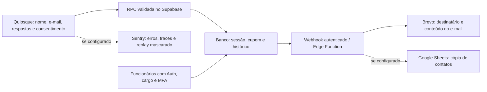

# Segunda revisão de pré-lançamento — Suaipe

Data: **06/11/2026**, Europe/Rome. Código avaliado: **8acdb6156e3223d94dd5533fed587be71ab7febe**. Branch de trabalho: `audit/prelaunch-2026-11-06`.

## Decisão recomendada

**Ainda não aprovar a liberação irrestrita com dados reais.** As proteções anteriores funcionam nos cenários testados, mas novos testes reproduziram falhas de autorização, integridade de exportações e recuperação de falhas. Não foi encontrada evidência de chave privilegiada nos alertas de segredos analisados. Isso não comprova ausência de outros segredos ou vulnerabilidades.

Para o LinkedIn, uma demonstração isolada com dados sintéticos pode ser preparada antes da operação real. Não conectar uma demonstração pública às listas de clientes ou às integrações reais de envio. As estatísticas e afirmações comerciais do README precisam de confirmação do autor; esta auditoria não verifica resultados de negócio externos.

Esta etapa acrescenta evidências, cenários reproduzíveis e um plano de correção. Não altera o código da aplicação nem comprova quais alterações estão implantadas na Vercel/Supabase.

## Como os três textos foram utilizados

Os arquivos enviados abordam governança, propriedade intelectual, privacidade, arquitetura, scanners, testes adversariais, desempenho e operação. O protocolo maior contém **317 itens**. Eles foram usados como referência de escopo, não como 317 controles automaticamente aprovados ou como obrigações legais universais.

Não foram validadas as estatísticas, referências externas ou alegações de alterações legislativas dos textos. A aplicabilidade de DPO, DPIA, consentimento de rastreadores, contratos e transferências internacionais depende da operação e exige avaliação própria. Não há integração de pagamentos nem chamada de LLM no fluxo examinado; os módulos específicos de PCI/cobranças e segurança de agentes em produção não se aplicam a esse fluxo. Usar IA no desenvolvimento não transforma o algoritmo de correspondência por tags em um LLM.

## Testes e análises executados agora

| Verificação | Resultado desta execução | Limite da evidência |
|---|---|---|
| TypeScript | Passou | Configuração `tsconfig.app.json` |
| ESLint | Zero erros; quatro avisos de Fast Refresh | Inclui os novos testes de diagnóstico |
| Suíte existente + cobertura | **155 testes / 22 arquivos passaram** | Cobertura unitária: **9,44% das linhas**, 9,15% das instruções e 4,76% das ramificações; não inclui cobertura de navegador ou SQL |
| Migrações e regressões SQL existentes | **24 verificações passaram** | PostgreSQL 17 local, Auth/Storage mínimos; não é Supabase hospedado |
| Novos cenários SQL | **13 cenários: 11 exposições/falhas observadas e duas proteções confirmadas** | Diagnóstico de comportamento; `VULNERABLE` não significa teste de segurança aprovado |
| Novos testes de interface/serviço | **Três falharam, reproduzindo defeitos** | CSV com fórmula, falso sucesso de exportação e requisição sem prazo máximo; mocks de transporte, sem navegador real |
| Concorrência de criação | **12 chamadas → uma sessão persistida** | Mesmo UUID e conteúdo; ambiente local |
| Concorrência de e-mail | **12 chamadas → uma reserva de envio** | Não envia e-mail; valida reserva SQL |
| Consulta com dados sintéticos | 20 mil linhas adicionais; consulta por e-mail realizou `Seq Scan`, cerca de **9,61 ms** | Uma medição local, cache aquecido; não é teste de capacidade, p95 ou SLA |
| Build de produção | Passou, incluindo geração da PWA | Backend fictício, sem integração real |
| Gitleaks 8.24.3 | Seis alertas no histórico local, todos classificados | Quatro placeholders e dois JWTs de papel `anon`; nenhum alerta de `service_role` confirmado |
| Gitleaks no build | Nenhum alerta em aproximadamente 1,23 MB examinados | Não certifica ausência de dados sensíveis nos arquivos ou serviços publicados |
| Semgrep 1.184.0 | 441 regras, 246 arquivos, 250 ocorrências, zero erros de análise | Triagem abaixo; ocorrências não equivalem a vulnerabilidades confirmadas |
| npm audit | Produção: **cinco moderados**, zero altos/críticos. Árvore completa: **15 moderados e dois baixos** | Retrato atual do feed; pode mudar sem alteração do código |
| SBOM e licenças | **734 componentes instalados**, inventário gerado | Metadados declarados, não análise de proveniência autoral ou certificação jurídica |
| Playwright | 16 testes descobertos; execução **não realizada** | WebKit ausente; domínios de download continuam fora da política de rede aplicada |

Os valores da auditoria de dependências diferem do relatório de 03/11 porque o feed foi consultado novamente. As saídas resumidas estão em [evidence.json](evidence.json), o inventário em [licenses.csv](licenses.csv) e o SBOM em [sbom.cdx.json](sbom.cdx.json).

### Triagem dos scanners

- **Gitleaks:** a busca incluiu `git --all` do histórico disponível localmente; o scanner reportou 421 commits com alterações examinadas. O repositório não é shallow. Isso não cobre objetos apagados e inacessíveis, arquivos mantidos fora do Git, secrets dos provedores ou forks não presentes. Valores não foram copiados para o relatório. As duas chaves `anon` históricas são destinadas a clientes públicos; sua segurança depende de RLS. Não há fundamento nesses alertas para afirmar vazamento de chave administrativa ou recomendar rotação de todas as chaves.
- **Semgrep:** 221 avisos de internacionalização, 12 de propagação de propriedades React, dois de interpolação de strings, um de propriedades em estado, 13 sobre composição de HTML em e-mail e um placeholder detectado como segredo. Os 13 pontos de HTML exigiram revisão contextual: nome, e-mail, produto e URLs têm codificação; título/subtítulo do template aceitam HTML administrativo cru e a sanitização principal fica no cliente. Recomenda-se uma lista permitida no servidor. Não foi demonstrado XSS de visitante a partir dos 13 avisos. Não descrever o total como “250 vulnerabilidades críticas”.
- **Supply chain:** 826 entradas resolvidas do lockfile apontam para `registry.npmjs.org`, com integridade declarada. Cinco entradas declaram scripts de instalação; revisar e restringir sua execução onde compatível. Isso não prova que cada biblioteca esteja livre de código malicioso. Scanners SAST/segredos ainda não fazem parte da CI atual.
- **Licenças:** dois componentes do CLI de Sentry declaram `FSL-1.1-MIT` e `caniuse-lite` declara `CC-BY-4.0`. O CLI pertence à cadeia de build, não ao JavaScript final por essa razão isolada. Revisar condições e atribuições conforme o uso/distribuição. Não foi identificada licença declarada GPL/AGPL/LGPL nesse inventário. Não é uma verificação de similaridade de todo o código gerado por IA nem de direitos sobre imagens, marcas e vídeos.

## Problemas e ações, em ordem de prioridade

P1 = corrigir antes de liberar o fluxo afetado com dados reais. P2 = tratar antes de ampliar a operação ou registrar uma decisão com mitigação. P3 = manutenção. Não foi demonstrado um P0 como acesso anônimo a toda a base de clientes; a ausência dessa demonstração não aprova o ambiente publicado.

| ID | Prioridade / evidência | Problema em linguagem simples | Ação e critério de conclusão |
|---|---|---|---|
| R01 | **P1**, DB06 | Um gerente com apenas senha consegue enviar mídia do catálogo, apesar da exigência de MFA nas tabelas | Aplicar MFA também às políticas de INSERT/UPDATE/DELETE de `storage.objects`; negar aal1 e manter aal2 autorizado. Validar pelo Storage real em staging |
| R02 | **P1**, DB13 + teste CSV | O servidor aceita nome `=1+1`; o CSV do Manager preserva a fórmula | Validar nomes no servidor e neutralizar fórmulas em todos os exportadores/integrações de planilha; testar `=`, `+`, `-`, `@`, espaços e caracteres de controle. Não foi executado payload externo nem demonstrada exfiltração |
| R03 | **P1**, teste de conexão parada + leitura do fluxo | Se o transporte não resolve, o envio fica aguardando; durante `claiming` o reset por inatividade está desligado | Definir timeout e tratamento de resultado ambíguo, preservar o UUID nas novas tentativas e permitir limpar a tela sem reviver callbacks antigos. Testar queda de rede e requisição pendurada |
| R04 | **P1**, revisão do código | Depois de uma tentativa, a tela ainda deixa alterar o e-mail, mas o corpo da solicitação permanece congelado no primeiro endereço | Bloquear edição nessa situação ou exigir reinício explícito; sempre mostrar o endereço realmente vinculado à solicitação. Preservar idempotência; nunca trocar silenciosamente o conteúdo sob o mesmo UUID |
| R05 | **P1 para coleta real**, revisão do código | O aviso cita Supabase/Brevo, mas o envio opcional ao Sheets copia nome, sobrenome e e-mail; Sentry também pode iniciar antes da escolha do visitante | Confirmar fornecedores ativos e finalidades, atualizar o aviso em todos os idiomas, avaliar telemetria e definir retenção/exclusão por fornecedor. O trecho não comprova que essas integrações estejam habilitadas em produção |
| R06 | **P2**, DB01 e DB11 | Dados do funil são legíveis por qualquer autenticado, sem MFA/loja, e visitantes podem inventar eventos de conversão com datas passadas | RLS por função/loja/MFA; gerar `claimed` a partir da criação efetiva da sessão; impor data e limites no servidor. Funil não contém os nomes/e-mails das sessões, mas revela atividade e pode distorcer métricas |
| R07 | **P2**, DB04 | Uma conta com MFA, mesmo sem cargo de funcionário, lê guias internos | Exigir cargo válido nas políticas de leitura dos guias e anexos. Verificar também se cadastro público está desabilitado; esse ajuste de Auth não foi observado |
| R08 | **P2**, DB05 | Uma conta sem cargo pode inserir uma ação no histórico usando a identidade de um gerente | Gerar histórico no servidor com identidade da sessão e vínculo à alteração real; rejeitar identidade/loja fornecidas pelo cliente |
| R09 | **P2**, DB07 e DB08 | Ao atingir o limite do PIN, a função dá erro `42702` por coluna ambígua; trocar o identificador do cliente contorna a contagem | Qualificar variáveis SQL e centralizar limitação persistente com origem confiável. Retirar fallback público que contorne o limite. O PIN por si só não concede a sessão Auth/MFA administrativa |
| R10 | **P2**, DB09 e DB10 | Um visitante consegue fabricar tentativas de login para bloquear a interface de outra pessoa e consultar atividade recente de e-mail | Retirar a autoridade do cliente sobre auditoria de login; usar controles de Auth/gateway. Eliminar a resposta pública que revela atividade e manter respostas genéricas |
| R11 | **P2**, DB12 e revisão de e-mail | Um webhook atrasado consegue reservar envio de cupom já vencido; o aceite do provedor é apresentado como entrega | Recusar/reconciliar sessão expirada antes do envio; separar aceite, entrega, bounce e falha. Estados `sending/uncertain` precisam de alerta e procedimento de reconciliação |
| R12 | **P2**, teste de exportação + revisão das consultas | Consulta negada produz “0 sessões exportadas com sucesso”; CSV/KPIs podem omitir dados por falta de paginação e limites | Tratar erro, exportar páginas de forma consistente com filtros e informar truncamento. Dashboard tem teto explícito de 5.000; o limite do projeto hospedado pode ser menor |
| R13 | **P2**, plano SQL | O limite por e-mail normalizado percorre a tabela, e a criação pública só limita cada endereço | Avaliar índice por e-mail normalizado/data e quota por origem/quiosque. Limitar por endereço não detém troca de e-mails. Definir tráfego esperado e medir p95/erros antes de escolher infraestrutura |
| R14 | **P2**, cobertura e configuração CI | Muitos testes de funções pequenas, mas faltam jornadas e controles de segurança em execução contínua | Converter reproduções em regressões que passem após correções, testar guards de cargo/MFA, recuperação e retry. Executar WebKit/iPad; adicionar SAST e segredos à CI com regras revisadas |
| R15 | **P2**, licenças/documentos | Faltam evidências completas de direitos de uso, atribuições e autorização para divulgar material corporativo | Revisar SBOM, avisos de terceiros, imagens/marcas/vídeos, termos de ferramentas de IA e eventuais direitos do empregador/cliente. Não inferir infração ou perda de autoria só pelo uso de IA |
| R16 | **P2**, evidência externa ausente | Não há restauração, alertas, quotas nem correspondência do deploy com este commit comprovadas nesta revisão | Demonstrar backup/restauração, RTO/RPO, recebimento de alerta e rollback coordenado. A migração muda o contrato: reverter apenas o frontend pode quebrar a gravação |
| R17 | **P3**, documentos | `CLAUDE.md` e runbook ainda descrevem INSERT direto, fallback de catálogo antigo e trechos de recuperação anteriores | Atualizar após correções; unificar contrato de envio e procedimento operacional com `docs/security-hardening.md` |

### Localização das principais evidências

- Storage sem MFA: [políticas de mídia](../../../supabase/migrations/20260519000004_storage_product_images_rls.sql), especialmente as condições de INSERT/UPDATE/DELETE. O teste adiciona ao Storage mínimo os grants de tabela/esquema usados pela API para exercitar **as políticas reais**; não substitui uma chamada ao serviço hospedado.
- Funil público/autenticado: [políticas iniciais](../../../supabase/migrations/20260407000003_funnel_events.sql) e [restrições posteriores](../../../supabase/migrations/20260507000003_funnel_events_hardening.sql). As restrições de formato/uniqueness não comprovam que uma conversão ocorreu.
- Leitura de guias: [políticas dos guias](../../../supabase/migrations/20260519000001_consultant_guides.sql). MFA foi acrescentado depois; cargo não foi exigido nessa leitura.
- Identidade de auditoria: [política de INSERT](../../../supabase/migrations/20260405000005_manager_audit_log.sql).
- PIN: [função SQL](../../../supabase/migrations/20260507000001_fix_verify_staff_pin_app_config.sql), particularmente a consulta de lockout; [fallback do cliente](../../../src/lib/verifyStaffPin.ts).
- CSV/falso sucesso: [exportador Manager](../../../src/components/manager/sessions/useSessionsData.ts), linhas 164–198. A função de exportação de Stats é outra implementação e já tem neutralização parcial; unificar e testar os dois caminhos.
- Requisição pendurada: [submitClaim](../../../src/lib/submitClaim.ts); [Index](../../../src/pages/Index.tsx), onde o reset é desativado durante o envio e o payload é congelado.
- Validação de nomes e expiração de envio: [migração de segurança](../../../supabase/migrations/20261103000001_release_security.sql), linhas 103–104 e 141–152.
- Compartilhamento: [on-session-created](../../../supabase/functions/on-session-created/index.ts), bloco `sheetsPayload`; [aviso](../../../src/components/PrivacyNotice.tsx); [Sentry](../../../src/main.tsx).

## Fluxo de dados e ameaças



| Dado / ativo | Finalidade atual observada | Onde aparece | O que precisa ser definido/verificado |
|---|---|---|---|
| Nome, sobrenome e e-mail | Personalização e envio do resultado | Navegador, Supabase, Brevo, Sheets opcional e CSV local | Necessidade, base por finalidade, retenção, destinatários, direito de correção/exclusão e contato real do responsável |
| Respostas, produto e match | Recomendação e análise da sessão | Supabase e parte das métricas | Minimização e prazo de conservação; não classificar preferências automaticamente como dado sensível |
| Consentimento | Registro da escolha do visitante | Timestamp na sessão | Acrescentar versão do aviso e contexto necessário; timestamp isolado não comprova todos os requisitos de consentimento |
| Eventos de funil | Medir abandono/conversão | Supabase | Integridade, escopo por loja, prazo, vínculo com eventos reais |
| Credenciais e sessões de staff | Operação administrativa | Auth, armazenamento de sessão no navegador, políticas SQL | MFA, revogação, recuperação, dispositivos compartilhados e configuração real do Auth |
| IP, agente de navegador e logs | Segurança e suporte | Logs de acesso/Edge e fornecedores | Retenção, acesso e minimização; mascaramento de replay não resolve automaticamente todo o tratamento de telemetria |
| Imagens/vídeos/marca | Catálogo e apresentação | Storage público, arquivos do site, serviços de mídia | Direitos de uso e escrita protegida; imagens do catálogo públicas são uma decisão de produto, não um vazamento por si só |

As ameaças prioritárias são: visitante automatizado criando contatos/eventos; senha de gerente comprometida sem segundo fator; conta com MFA mas sem cargo; funcionário tentando mudar loja/identidade; provedor com falha ou timeout; exclusão acidental/implantação incompatível. R01–R16 ligam esses cenários às ações e evidências. Responsável técnico proposto: mantenedor do projeto; decisões sobre finalidades, direitos e contratos: responsável pela operação, com assessoria quando necessária.

## Matriz de aplicação do protocolo

| Família dos textos | Estado | Próxima evidência necessária |
|---|---|---|
| GOV / THR / AI-DEV | Parcial | Inventário de responsáveis, autorização de material corporativo, revisão humana dos componentes críticos e permissões reais de ferramentas |
| SUP / SEC | Parcial | SBOM e scans disponíveis; concluir atribuições e incluir verificação contínua de novos segredos |
| AUTH / ACL / DB | Falhas confirmadas e proteções parciais | Fechar R01/R06–R10 e repetir no Supabase de staging com contas próprias |
| API / WEB / FILE | Parcial | Fechar CSV/timeout/retry; validar uploads, CSP efetiva e fluxo de recuperação no navegador |
| QA-SEC / pentest / revisão humana | Parcial | WebKit, DAST/API em staging autorizado e revisão independente do código crítico |
| PRIV / EU / BR | Pendência de operação e validação jurídica | Mapa final de fornecedores, aviso, retenção, contratos, direitos e avaliação de aplicabilidade; nenhum selo de conformidade emitido |
| PAY | Não aplicável ao fluxo examinado | Reavaliar se adicionar pagamentos |
| LLM em produção | Não aplicável ao fluxo examinado | Reavaliar se adicionar modelos/agentes; controles do processo de desenvolvimento continuam pertinentes |
| INF / DR / OPS | Não comprovado externamente | Restore, alertas, quotas, acesso aos painéis e plano de incidente com responsáveis |
| WARM / FUNC | Parcial | Tráfego-alvo e teste gradual em staging, soak, iPad, teclado, acessibilidade e uso real de e-mail |
| GO / NO-GO | Liberação com dados reais pendente | Encerrar P1, comprovar staging, navegador, recuperação e aceitar formalmente riscos restantes |

CSRF foi considerado conforme a arquitetura: o cliente usa o SDK com tokens Bearer; não foi encontrada uma sessão de aplicação baseada em cookies que justifique afirmar ausência de token CSRF como falha universal. CORS e headers declarados não substituem autorização nem comprovam sua aplicação na Vercel.

## Ordem prática do trabalho

1. **Fechar acessos e integridade:** Storage/MFA, guias, funil e auditoria; PIN/login; CSV e nomes no servidor. Resultado: cenários indevidos negados, perfis legítimos mantidos.
2. **Fechar recuperação e privacidade:** timeout, callbacks e e-mail congelado; estados de entrega/expiração; mapa Sheets/Sentry, retenção/exclusão e aviso versionado. Resultado: falha de rede não deixa dados presos na tela nem entrega um endereço diferente do mostrado.
3. **Validar release em staging:** aplicar banco + Edge + frontend em conjunto, executar regressões SQL e os três novos testes já corrigidos; WebKit/iPad e fluxos Auth/MFA/recuperação; verificar headers, gateway do webhook e inbox real. Resultado: versão reproduzível identificada pelo commit e pelo artefato.
4. **Preparar operação e divulgação:** restore testado, alertas recebidos, quotas/custos, teste de carga dimensionado e direitos sobre material. Preparar demo sintética e capturas sem dados de clientes. Resultado: checklist de liberação com responsável, evidência e riscos aceitos.

Não é necessário adotar todas as ferramentas citadas nos textos ao mesmo tempo. É necessário produzir evidência útil para esses resultados, preservando as verificações existentes e incluindo os casos novos após as correções.

## Como reproduzir

Executar a partir da raiz do repositório, com Node 24 e dependências instaladas pelo lockfile:

```bash
npm run typecheck
npm run lint
npm run test:coverage -- --maxWorkers=2
npm run test:db
bash docs/audits/2026-11-06/run-probes.sh
npx vitest run --config docs/audits/2026-11-06/vitest.probes.config.ts --maxWorkers=2
```

O script SQL cria PostgreSQL descartável sem publicar porta e remove o container ao terminar; **não usar em banco hospedado**. Ele imprime a tabela de diagnóstico, confirma invariantes de concorrência e mede uma consulta sintética. Retorno zero do script significa execução concluída, não ausência de vulnerabilidades: consultar `result` na tabela. O teste Vitest separado **retorna erro enquanto os três defeitos persistirem**. A suíte normal continua com seus 155 testes; os diagnósticos não foram escondidos, desativados ou tratados como aprovação.

Para reproduzir scanners, usar Gitleaks 8.24.3 (artefato oficial com checksum verificado) e Semgrep 1.184.0 com as regras JavaScript/TypeScript/generic do repositório `semgrep/semgrep-rules`, commit `16b9e6d45f10649f6a531ec4838ed9924372c3bc`, métricas desativadas. No ambiente gerenciado, as pastas de log/configuração do scanner podem precisar apontar para `/tmp`. Não enviar valores de secrets para relatórios ou chats.

```bash
gitleaks git . --log-opts=--all --redact=100 --report-format=json --report-path=/tmp/history-redacted.json
gitleaks dir dist --redact=100 --report-format=json --report-path=/tmp/build-redacted.json
npm audit --json
npm audit --omit=dev --json
npm sbom --sbom-format=cyclonedx
```

### Limites externos

Nenhum teste ativo, carga ou migração foi executado contra produção. Não havia configuração runtime de Supabase/Vercel nesta instância. Não foram verificados painel de deploy, branch protection, cadastro público, revogação de tokens, DNS/SPF/DKIM/DMARC, contratos, mailbox de privacidade, restauração de backup, notificações de alertas ou headers efetivos do site. O WebKit está ausente e seus hosts de download não estão liberados na política aplicada; a liberação salva em rascunho anteriormente não equivale à ativação. Esses pontos permanecem **não verificados**, não “aprovados” nem automaticamente “inexistentes”.
