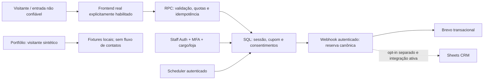

# Escopo, ativos, ameaças e riscos

07/11/2026. Release candidata 2.1.0, branch `fix/security-and-release-hardening`. Declaração do autor nesta conversa: projeto de portfólio pessoal de **Costanzo Annichini**, público europeu, principalmente Itália, Portugal, Espanha e França. Marketing por e-mail é uma ideia futura condicionada à autorização do cliente. Não há contato real de privacidade informado; `suaipe@example.invalid` é exemplo reservado e não monitorado.

## Dois escopos de liberação

**Portfólio atual:** catálogo/visitante sintéticos, sem credenciais de funcionários, gravação de contatos, mensagens reais ou marketing. Demo é o padrão em qualquer build, inclusive Vercel Production. Para pedir operação real são necessários `VITE_DEMO_MODE=false` **e** `VITE_ALLOW_REAL_CUSTOMER_DATA=true`; produção real também rejeita ausência de responsável/contato e contatos reservados de exemplo. Essa segunda variável evita que uma configuração antiga com demo=false ative coleta por acidente. O código não confirma a configuração atualmente aplicada na Vercel.

**Operação futura com dados reais:** depende de ambiente segregado, responsável operacional e contato real, aviso/finalidades/fornecedores revisados, revisão humana do código crítico, migrações/funções/scheduler coordenados, testes hospedados e recuperação/alertas comprovados. O projeto ainda não recebeu essa aprovação.

## Inventário e fronteiras

| Ativo | Papel / fronteira | Fonte de configuração |
|---|---|---|
| GitHub ProgAnakin/Suaipe | Código, lockfile, CI, evidências; branch principal e branch candidata são diferentes | Git + workflows versionados; forks/branch protection dependem do painel |
| Navegador/quiosque | Entrada não confiável; JavaScript não é autoridade para cargo/preço/envio | React/Vite; preferências locais; tokens de staff em sessionStorage |
| Vercel | Hospedagem da SPA/PWA, TLS, headers e logs técnicos | `vercel.json`, variáveis do projeto e `/release.json` |
| Supabase Auth / PostgREST / SQL | Identidade, tokens, MFA, cargo, loja, sessão e cupom | Migrações/RLS/RPCs; projeto real e Auth ainda não inspecionados |
| Supabase Storage | Imagens públicas de catálogo; escrita gerente+MFA; nenhum cadastro de cliente nesse bucket | Políticas, limite 5 MB e MIME raster; conteúdo cliente é decodificado/regravado |
| Edge Functions | PIN, webhook canônico, relay autorizado e manutenção | Quatro funções; secrets só de serviço; gateway/XFF real pendente |
| Brevo | Envio transacional do resultado, se operação real | Secret/sender/DNS/contrato e limites não confirmados |
| Google Apps Script/Sheets | Cópia CRM opcional, agora somente com opt-in separado e não retirado | Flag explícita, endpoint de fornecedor com redirects limitados |
| Sentry | Erros minimizados opcionais; sem replay/tracing; desligado na demo | Flags de runtime/build e contrato próprios |
| Ferramentas de desenvolvimento | npm/lock, scanners, Deno nativo e Chromium local | Não recebem dados de clientes nem credenciais de produção nesta execução |

O endereço histórico `suaipe.vercel.app` não prova o deploy desta branch. O projeto Supabase histórico em configurações versionadas não confirma o ambiente atual. Serviços experimentais, consoles, outros projetos, forks e contas abandonadas precisam ser inventariados pelo titular dos painéis; não podem ser descartados pela leitura deste checkout.

## Fluxo e ameaças

| Ameaça | Prevenção / detecção local | Recuperação / evidência ainda necessária |
|---|---|---|
| Visitante fabrica campos, UUIDs, consentimento ou conversões | Validação SQL, campos canônicos, idempotência, quotas e evento claimed no commit; teste de manipulação | Bots e propriedade do endereço não são comprovados pelas quotas. Double opt-in e supressão devem ser definidos antes de campanhas |
| Credencial de funcionário roubada | MFA, cargo/loja no banco, PIN de serviço e negação a aal1 | Exercitar Auth, MFA/revogação e gateway reais; TOTP não é resistente a phishing |
| Conta sem cargo tenta ler/exportar | RLS/RPCs, guards e regressões de conta sem função | Testar PostgREST, Storage e Realtime hospedados com contas próprias A/B |
| Gerente ou dependência comprometidos | Menor privilégio, restrição de corpo/destinos, auditoria de mutação, scanners e CODEOWNERS | Administrador autorizado continua tendo grande impacto; revisão independente, proteção real da branch e plano de revogação |
| Provedor falha ou timeout ocorre após commit | Retry com UUID/corpo imutáveis; reservas atômicas, estados ambíguos e saúde autenticada | Reconciliar aceite versus entrega; não reenviar em massa nem prometer exactly-once entre sistemas |
| Dispositivo compartilhado expõe visitante/staff | Reset, cancelamento, limpeza de marcadores e bloqueio local imediato mesmo offline | Ensaiar iPad, suspensão/retomada, mudança de conta e revogação remota. Offline não garante revogação no servidor |
| Exclusão acidental, retenção ou operador apaga dados | Migrações em transação, confirmação de UI, fila externa e restore sintético | Restaurar backup/arquivos reais em isolamento, medir RTO/RPO e testar retorno coordenado |
| Upload malformado ou integração aponta para rede interna | Limites de bytes/pixels, assinatura raster e re-encode; destino Sheets/redirects limitado a hosts do fornecedor | Storage hospeda somente mídia pública gerencial; validar o serviço real e política de metadados/antimalware proporcional |

Ativos prioritários futuros: contatos/consentimentos, tokens de staff/serviço, integridade do cupom/catálogo, disponibilidade, cópias externas e direito de uso do material. Atores: visitante anônimo, automação, conta comprometida, funcionário/gerente malicioso e fornecedor comprometido. Logs por sessão UUID são pseudonimizados e continuam sujeitos a acesso/retenção.

Responsável técnico proposto: Costanzo Annichini. Responsáveis jurídicos, incidentes, substituto operacional, RTO/RPO e limites financeiros ainda precisam de confirmação. Alterações de dependências/arquitetura devem passar por PR com impacto, testes e revisão dos arquivos críticos; mudanças emergenciais também precisam de registro e revisão posterior. Não prometer custo zero nem direitos autorais exclusivos com base apenas na geração assistida por IA.
